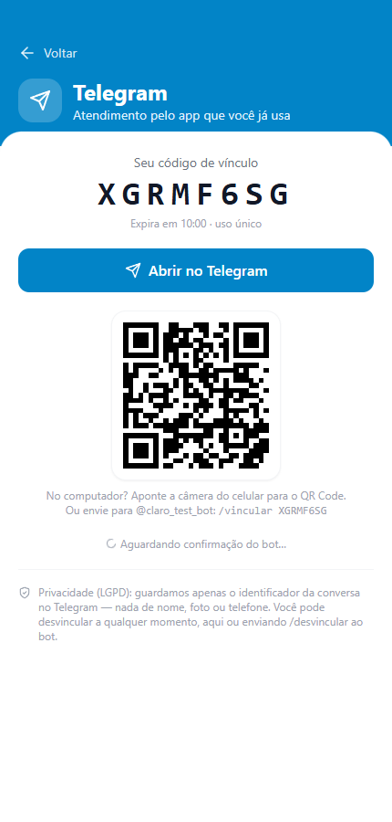
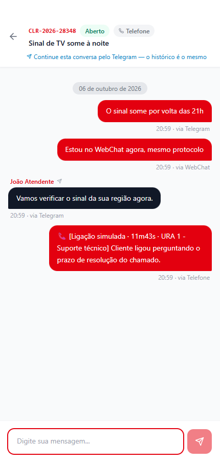
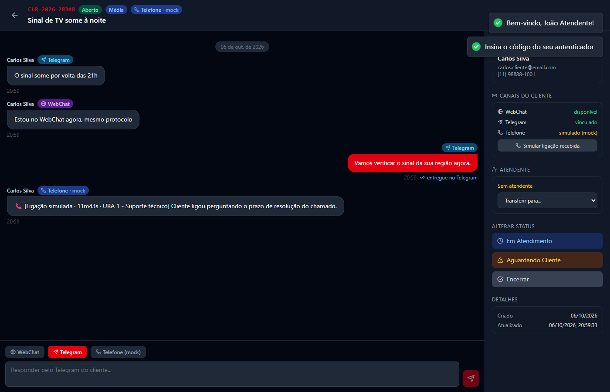
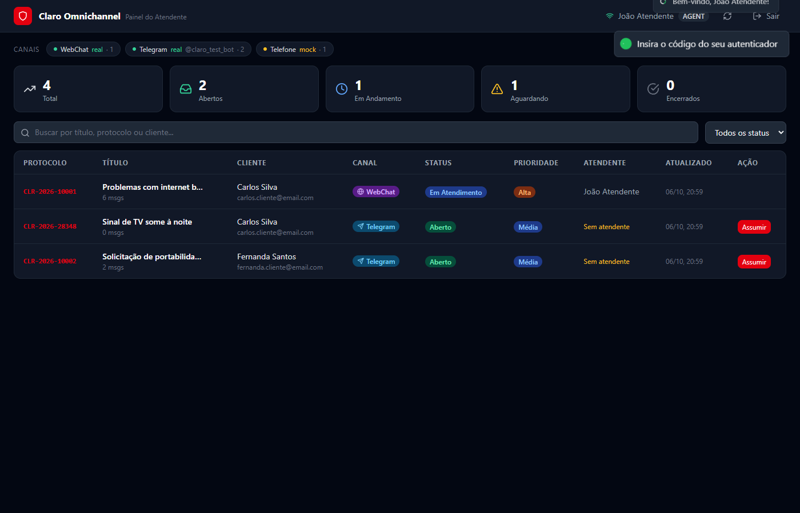

# Claro Omnichannel — PoC de Unificação de Canais de Atendimento

> **Projeto acadêmico FIAP** em parceria com a **Claro Brasil**
> Desafio: o cliente abre um chamado em um canal, é transferido para outro e perde o histórico.

**Ideia central:** um único **protocolo** (`CLR-AAAA-NNNNN`) com uma única **linha do tempo**, não importa por qual canal o cliente fale. Telegram → telefone → WebChat: tudo no mesmo protocolo, em tempo real, para o cliente e para o atendente.

| Canal | Situação | Como funciona |
|---|---|---|
| **WebChat** (app do cliente, PWA) | ✅ **Real** | React PWA + REST + WebSocket |
| **Telegram** | ✅ **Real** | Bot oficial ([@claro_omnichannel_mathcerq_bot](https://t.me/claro_omnichannel_mathcerq_bot)) via Telegram Bot API, *long polling* |
| **Telefone** | 🧪 **Mock assumido** | Simulado **de propósito**: ligações e dados são inventados. Não há integração com telefonia |

> O WhatsApp, que aparecia nas versões anteriores, foi substituído pelo Telegram como canal de mensageria **real**: a API do WhatsApp Business exige conta comercial verificada pela Meta, o que não cabe numa PoC acadêmica. A arquitetura aceita o WhatsApp como um novo *adapter* sem mudar o núcleo (veja [Como adicionar um canal](#como-adicionar-um-canal)).

---

## Sumário

1. [Como rodar](#1-como-rodar)
2. [Configurar o bot do Telegram](#2-configurar-o-bot-do-telegram)
3. [Roteiro de demonstração](#3-roteiro-de-demonstração)
4. [Arquitetura](#4-arquitetura)
5. [Canal telefone: mock assumido](#5-canal-telefone-mock-assumido)
6. [Segurança e LGPD](#6-segurança-e-lgpd)
7. [Modelo de dados](#7-modelo-de-dados)
8. [API REST](#8-api-rest)
9. [Eventos WebSocket](#9-eventos-websocket)
10. [Testes](#10-testes)
11. [Estrutura de pastas](#11-estrutura-de-pastas)
12. [Limitações e próximos passos](#12-limitações-e-próximos-passos)

---

## 1. Como rodar

### Pré-requisitos

- **Node.js 18+** (testado com Node 24) e **npm 9+**
- **Google Chrome**, só para os testes de navegador (Playwright usa o Chrome instalado)

### Passo a passo

```bash
# 1. Variáveis de ambiente do backend (o .env NUNCA é versionado)
cp backend/.env.example backend/.env
#    Edite backend/.env e preencha JWT_SECRET, JWT_REFRESH_SECRET e TOTP_ENCRYPTION_KEY
#    com valores aleatórios (comando de exemplo dentro do arquivo).
#    Para o Telegram, preencha TELEGRAM_BOT_TOKEN (seção 2). Vazio = Telegram desligado.

# 2. Instala tudo, cria o banco SQLite e popula com dados de demonstração
npm run setup

# 3. Sobe API + painel do atendente + app do cliente (um terminal só)
npm run dev
```

| Serviço | URL |
|---|---|
| API (NestJS) + WebSocket | http://localhost:3000 |
| Painel do atendente | http://localhost:5173 |
| App do cliente (PWA / WebChat) | http://localhost:5174 |

Outros comandos úteis (na raiz):

| Comando | O que faz |
|---|---|
| `npm run db:reset` | Apaga o banco, reaplica as migrações e roda o seed |
| `npm test` | Testes unitários + e2e do Telegram + e2e de interface |
| `npm run test:e2e:2fa` | Login com 2FA no navegador (exige `npm run dev` rodando) |

### Credenciais de demonstração

Senha de todas as contas: **`Claro@2024`**

| Perfil | E-mail | Onde entra | 2FA |
|---|---|---|---|
| Admin | admin@claro.com.br | Painel (:5173) | Obrigatório |
| Supervisor | supervisor@claro.com.br | Painel (:5173) | Obrigatório |
| Atendente | joao.atendente@claro.com.br | Painel (:5173) | Obrigatório |
| Atendente | maria.atendente@claro.com.br | Painel (:5173) | Obrigatório |
| Cliente | carlos.cliente@email.com | App (:5174) | Opcional |
| Cliente | fernanda.cliente@email.com | App (:5174) | Opcional |
| Cliente | roberto.cliente@email.com | App (:5174) | Opcional |

No primeiro login de um perfil privilegiado, o sistema exige configurar o 2FA (QR Code para Google Authenticator, Authy etc.) antes de liberar qualquer acesso.

| Protocolo (seed) | Cliente | Jornada |
|---|---|---|
| CLR-2026-10001 | Carlos | Telegram → Telefone (mock) → WebChat |
| CLR-2026-10002 | Fernanda | Telegram |
| CLR-2026-10003 | Roberto | Telefone (mock) |

---

## 2. Configurar o bot do Telegram

1. No Telegram, fale com o [@BotFather](https://t.me/BotFather) → `/newbot` → escolha nome e *username* → copie o **token**.
2. Coloque o token em `backend/.env`:
   ```env
   TELEGRAM_BOT_TOKEN=<token do BotFather>
   ```
3. Rode `npm run dev`. No log da API deve aparecer:
   ```
   [TelegramPolling] Bot @seu_bot conectado — long polling iniciado.
   ```

**Por que long polling?** O backend busca as mensagens no Telegram (`getUpdates`), em vez de o Telegram chamar o backend (webhook). Assim, roda em qualquer máquina local sem expor o servidor nem precisar de HTTPS público. Ao iniciar, o backend remove qualquer webhook, registra os comandos do bot e, se a rede cair, tenta de novo com espera crescente.

> ⚠️ Só **uma** instância pode fazer long polling de um mesmo bot por vez. Se aparecer `Conflito (409)` no log, há outro backend usando o mesmo token (por exemplo, em outro computador).

**Segurança do token:** fica só no `backend/.env` (ignorado pelo git). O token faz parte da URL da Bot API, então o cliente HTTP oculta (`***`) qualquer ocorrência dele em erros e logs, e há teste automatizado garantindo isso.

### Como o cliente vincula o Telegram

O vínculo usa um **código de uso único gerado no WebChat, com o cliente já logado**. Isso prova que a mesma pessoa controla a conta e o Telegram. Vincular só pelo e-mail permitiria que qualquer pessoa digitasse o e-mail de outra e lesse os protocolos dela.

1. No app (:5174) → **Conectar Telegram** → **Gerar código de vínculo**.
2. Toque em **Abrir no Telegram** (deep link `t.me/<bot>?start=CÓDIGO`) ou leia o QR Code. Também dá para enviar `/vincular CÓDIGO` ao bot.
3. O bot confirma e o app atualiza na hora ("Telegram conectado").

Regras: o código tem 8 caracteres, vale 10 minutos e só pode ser usado uma vez. Apenas o hash SHA-256 fica salvo, e há bloqueio após 5 tentativas inválidas por chat. Um chat corresponde a um cliente.

### Comandos do bot

| Comando | O que faz |
|---|---|
| *(texto livre)* | Registra no protocolo ativo. Se não houver, **reaproveita** o protocolo aberto mais recente ou **cria** um novo |
| `/novo assunto` | Abre um novo protocolo |
| `/protocolos` | Lista os protocolos em aberto (👉 marca o ativo) |
| `/usar CLR-AAAA-NNNNN` | Escolhe em qual protocolo continuar |
| `/historico` | Últimas mensagens do protocolo, **de todos os canais** |
| `/status` | Situação, atendente e último canal |
| `/desvincular` | Remove o vínculo (direito do titular, LGPD) |
| `/ajuda` | Ajuda |

O bot só atende em conversa **privada** (recusa grupos), envia texto puro (sem HTML/Markdown) e limita a 20 mensagens por minuto por chat.

---

## 3. Roteiro de demonstração

Teste manual com o bot real **@claro_omnichannel_mathcerq_bot** (com `npm run dev` rodando e o token no `.env`):

1. **Cliente no WebChat:** entre em http://localhost:5174 como `carlos.cliente@email.com` → **Conectar Telegram** → **Gerar código** → **Abrir no Telegram** → *Iniciar*. O app mostra "Telegram conectado".
2. **Cliente no Telegram:** envie `/protocolos` para ver o CLR-2026-10001 vindo do seed, ou `/novo Internet caindo à noite` para abrir um novo protocolo. Depois mande uma mensagem livre.
3. **Atendente:** entre em http://localhost:5173 como `joao.atendente@claro.com.br` (com 2FA). O protocolo aparece na lista **sem recarregar** e a mensagem do Telegram chega **ao vivo** na tela do protocolo.
4. **Atendente responde pelo Telegram:** com o canal **Telegram** selecionado (padrão quando o cliente escreveu por lá), a resposta chega ao Telegram do cliente e o painel mostra "✓ entregue no Telegram".
5. **Troca de canal:** no app (:5174), abra o mesmo protocolo e escreva pelo WebChat. Mesmo número, mesma timeline, cada mensagem com seu canal. No Telegram, `/historico` mostra as mensagens dos dois canais.
6. **Telefone (mock):** no painel, **Simular ligação recebida**. Entra uma "ligação" com dados inventados na mesma timeline.
7. **Encerramento:** no painel, **Encerrar**. O cliente recebe o aviso no Telegram, e a próxima mensagem abre outro protocolo (o encerrado não é reaberto).

| Vincular Telegram (app) | Timeline unificada (app) |
|---|---|
|  |  |





*Capturas geradas pelo teste automatizado de interface, que usa um servidor fake da Bot API (por isso o bot aparece como `@claro_test_bot`).*

---

## 4. Arquitetura

```
 ┌────────────────────┐       ┌──────────────────────────────────────────────────────────┐
 │ App do cliente     │ REST  │                    backend (NestJS)                       │
 │ PWA :5174 (WebChat)│◄─────►│                                                          │
 └────────────────────┘  WS   │   ┌──────────────── NÚCLEO ────────────────┐             │
 ┌────────────────────┐       │   │ ProtocolsService   MessagesService      │             │
 │ Painel atendente   │◄─────►│   │ (protocolo único)  (timeline unificada) │             │
 │ React :5173        │       │   └──────────────┬──────────────────────────┘             │
 └────────────────────┘       │        publica   │ eventos de domínio                     │
                              │                  ▼ (message.created, protocol.updated…)   │
 ┌────────────────────┐       │   ┌───────────────────┐   ┌──────────────────────────┐   │
 │ Telegram           │ long  │   │ EventsGateway     │   │ ChannelRegistry          │   │
 │ (Bot API)          │◄─────►│   │ Socket.io (salas  │   │  ├ WebchatAdapter  REAL  │   │
 └────────────────────┘ poll  │   │ por usuário/staff/│   │  ├ TelegramAdapter REAL  │   │
                              │   │ protocolo)        │   │  └ PhoneMockAdapter MOCK │   │
                              │   └───────────────────┘   └──────────────────────────┘   │
                              │   Auth (JWT + TOTP) · Guards (Throttler → JWT → Roles)    │
                              │   Prisma ORM → SQLite                                     │
                              └──────────────────────────────────────────────────────────┘
```

### Como o histórico se mantém ao trocar de canal

- O **protocolo** é a entidade central e o canal é só um atributo de cada mensagem (`Message.channel`). O `Protocol.currentChannel` registra por onde foi o último contato.
- **Toda** mensagem, de qualquer canal, passa por `MessagesService`: a do WebChat chega via REST e as dos canais externos via `createInbound()`. O registro vai sempre para o mesmo protocolo.
- O núcleo publica **eventos de domínio** (`@nestjs/event-emitter`). Quem reage são os assinantes:
  - `EventsGateway` repassa as mudanças ao painel e ao app via WebSocket, sempre na sala certa, nunca em broadcast;
  - `ChannelDispatcher` entrega as respostas do atendente pelo canal escolhido (Telegram envia de verdade; Telefone apenas registra a simulação) e grava o status de entrega (`SENT`, `FAILED`, `SIMULATED`).
- A entrada é **idempotente**: `(channel, externalId)` é único, então se o Telegram reentregar uma mensagem ela não duplica na timeline.

### Como adicionar um canal

Exemplo: WhatsApp Business ou e-mail.

1. Crie `backend/src/channels/<canal>/` com um `ChannelAdapter` (`info`, `isAvailableFor`, `deliver`).
2. Para receber mensagens, chame `MessagesService.createInbound({ protocolId, channel, content, externalId })`.
3. Registre o adapter no `onModuleInit` do módulo (`registry.register(adapter)`) e importe o módulo no `AppModule`.
4. Inclua o código do canal em `CHANNEL_CODES` (`channel.types.ts`).

Não é preciso alterar protocolos, mensagens, WebSocket nem guards. Trocar o telefone mock por uma integração real é só registrar outro adapter com `code: 'PHONE'`.

| Padrão | Onde |
|---|---|
| Monólito modular | Módulos NestJS independentes (DI) |
| Adapter + Registry | `channels/` (canais plugáveis) |
| Eventos de domínio | `events/domain-events.ts` + `@OnEvent` |
| Repository | Prisma ORM |
| Guard chain | `ThrottlerGuard → JwtAuthGuard → RolesGuard` (globais) |
| Validação de entrada | DTOs com `class-validator` (`whitelist` + `forbidNonWhitelisted`) |

---

## 5. Canal telefone: mock assumido

O canal telefone é **simulado de propósito**: não há URA, PABX nem CTI. Isso está explícito no código (`channels/phone-mock/`), na API (`GET /channels` retorna `kind: "MOCK"`) e na interface (badges "Telefone · mock" e "simulado (mock)").

- **Ligação recebida (simulada):** botão *Simular ligação recebida* no painel, que chama `POST /channels/phone/mock-call`. O sistema gera uma ligação com dados **inventados** (número fictício `(11) 90000-0XXX`, duração e opção de URA aleatórias, resumo fictício) e a registra na timeline pelo mesmo caminho dos canais reais.
- **Resposta "por telefone":** o atendente escolhe *Telefone (mock)* e escreve uma anotação da ligação, que fica na timeline com status `SIMULATED`. Nada é enviado a lugar nenhum.

O que o mock demonstra é a **continuidade do histórico**, que é o objetivo do desafio, e não a telefonia em si.

---

## 6. Segurança e LGPD

### Autenticação

- **Senhas** com bcrypt (custo 12).
- **2FA TOTP** (RFC 6238, `otplib`) **obrigatório** para AGENT, SUPERVISOR e ADMIN. O segredo é cifrado com AES antes de ir para o banco.
  - Um perfil privilegiado sem 2FA recebe um `setupToken` (10 min) que só acessa `/auth/totp/*`. Qualquer outra rota responde 403, e esse token também **não abre WebSocket**.
  - **Anti-replay:** cada código TOTP vale uma única vez (último passo aceito gravado com atualização condicional).
- **JWT** HS256 com segredos distintos: `accessToken` de 15 min e `refreshToken` de 7 dias. Os frontends **renovam automaticamente** e o WebSocket reautentica ao reconectar.
- Sem segredos com valor padrão no código: a API **não sobe** se faltar `JWT_SECRET`, `JWT_REFRESH_SECRET` ou `TOTP_ENCRYPTION_KEY`.
- **Cadastro público cria sempre CLIENT.** O campo `role` é rejeitado com 400; antes era possível se cadastrar como ADMIN.

### Autorização (RBAC + menor privilégio)

Regra única em `protocols/protocol-access.ts`, aplicada na API REST e no WebSocket:

| Perfil | Acessa |
|---|---|
| ADMIN / SUPERVISOR | Todos os protocolos |
| AGENT | Os atribuídos a ele e os da fila (sem atendente) |
| CLIENT | Apenas os próprios |

As salas do WebSocket seguem a mesma regra. Os eventos vão para `user:{id}`, `staff` ou `protocol:{id}`, nunca em broadcast global.

### LGPD

| Princípio / direito | Implementação |
|---|---|
| Necessidade (art. 6º, III) | Menor privilégio para atendentes; do Telegram guardamos **apenas o chat id** (nada de nome, username ou telefone) |
| Segurança (art. 46) | bcrypt, AES no segredo TOTP, hash SHA-256 dos códigos de vínculo, token do bot fora do código e dos logs, conteúdo de mensagens fora dos logs |
| Acesso e portabilidade (art. 18, II e V) | `GET /users/me/data` + botão **Baixar meus dados** no app (JSON com cadastro, protocolos, mensagens de todos os canais e acessos) |
| Revogação do consentimento (art. 18, IX) | `/desvincular` no bot ou botão no app: apaga o vínculo do Telegram |
| Rastreabilidade (art. 37) | `AuditLog`: logins, falhas de 2FA, vínculo/desvínculo do Telegram, criação, alteração e atribuição de protocolos, exportação de dados |

### Outros controles

Helmet (headers OWASP); rate limit global de 120 req/min por IP, 10/min no login e no 2FA e 5/min na geração de código; DTOs com whitelist; mensagens com no máximo 4000 caracteres.

### Testes de segurança

Itens 1 a 6: verificação manual com `curl` contra a API (revalidados em 06/10/2026). Item 7: `e2e-test.mjs`. Itens 8 a 16: automatizados em `tests/e2e-telegram.mjs`.

| # | Controle | Resultado esperado |
|---|---|---|
| 1 | Endpoint protegido sem token | 401 |
| 2 | CLIENT acessando rota de atendente (`/protocols/stats`) | 403 |
| 3 | Cliente acessando protocolo de outro cliente | 403 |
| 4 | Rate limit no login (mais de 10/min por IP) | 429 |
| 5 | Headers do Helmet presentes | ✅ |
| 6 | Senha armazenada como `$2b$12$…` | ✅ |
| 7 | `setupToken` fora de `/auth/totp/*` | 403 (`e2e-test.mjs`) |
| 8 | Cadastro público com `role: ADMIN` | 400 ✅ automatizado |
| 9 | `setupToken` abrindo WebSocket | recusado ✅ automatizado |
| 10 | Cliente entrando na sala WebSocket de outro cliente | recusado ✅ automatizado |
| 11 | Atendente acessando protocolo de outro atendente (REST e WS) | 403 ✅ automatizado |
| 12 | Reuso do mesmo código TOTP | 401 ✅ automatizado |
| 13 | Código de vínculo reutilizado ou inválido | recusado ✅ automatizado |
| 14 | Cliente forjando canal `TELEGRAM` via REST | gravado como `WEBCHAT` ✅ automatizado |
| 15 | Token do bot nos logs | nunca aparece ✅ automatizado |
| 16 | Exportação de dados contendo hash de senha ou segredo TOTP | não contém ✅ automatizado |

---

## 7. Modelo de dados

```
User ──< Protocol (clientId / agentId) ──< Message
 │                                          channel: WEBCHAT | TELEGRAM | PHONE
 │                                          externalId? (único por canal → idempotência)
 │                                          deliveryStatus? SENT | FAILED | SIMULATED
 ├──< ChannelIdentity   canal + externalId (chat id do Telegram) + protocolo ativo
 ├──< ChannelLinkCode   hash do código de vínculo, expiração, uso único
 ├──< AuditLog          ação, recurso, IP, data
 └── totpSecret (AES) · totpEnabled · totpLastUsedStep (anti-replay)

Protocol: protocolNumber (CLR-AAAA-NNNNN, único) · status OPEN|IN_PROGRESS|WAITING|CLOSED
          priority LOW|MEDIUM|HIGH|URGENT · currentChannel (último contato)
```

Migrações em `backend/prisma/migrations/`. SQLite na PoC; para produção, basta trocar o `provider` para PostgreSQL.

---

## 8. API REST

Todas as rotas exigem JWT, exceto as marcadas como públicas.

| Método | Rota | Perfis | Descrição |
|---|---|---|---|
| POST | `/auth/register` | público | Cadastro (sempre CLIENT) |
| POST | `/auth/login` | público | Login: tokens, `requiresOtp` ou `requiresTotpSetup` |
| POST | `/auth/verify-otp` | público | Valida o código TOTP |
| POST | `/auth/refresh` | público | Renova o accessToken |
| GET | `/auth/me` | todos | Usuário logado |
| GET/POST | `/auth/totp/setup` · `/enable` · `/disable` | todos | Gestão do 2FA |
| GET | `/protocols` | todos | Lista (filtrada por perfil) |
| POST | `/protocols` | CLIENT | Abre protocolo (canal WEBCHAT) |
| GET | `/protocols/stats` | staff | Contadores, incluindo protocolos por canal |
| GET | `/protocols/:id` | com acesso | Detalhe + timeline + `availableChannels` |
| PATCH | `/protocols/:id` | staff | Status, prioridade |
| PATCH | `/protocols/:id/assign` | staff | Assumir ou transferir |
| GET | `/protocols/:id/messages` | com acesso | Timeline |
| POST | `/protocols/:id/messages` | com acesso | Envia mensagem (cliente = WEBCHAT; atendente escolhe o canal) |
| GET | `/channels` | todos | Canais e tipo (`REAL` / `MOCK`) |
| GET | `/channels/telegram` | CLIENT | Status do vínculo |
| POST | `/channels/telegram/link-code` | CLIENT | Gera código de vínculo + deep link |
| DELETE | `/channels/telegram/link` | CLIENT | Desvincula |
| POST | `/channels/phone/mock-call` | staff | 🧪 Simula ligação recebida |
| GET | `/users/me/data` | todos | Exportação LGPD |
| GET | `/users` · `/users/:id` | ADMIN, SUPERVISOR | Usuários |
| GET | `/users/agents` | staff | Atendentes (para transferência) |
| PATCH | `/users/:id/status` | ADMIN | Ativa ou desativa usuário |

---

## 9. Eventos WebSocket

Conexão: `io('http://localhost:3000', { auth: { token: '<accessToken>' } })`. Tokens restritos ou inválidos recebem `unauthorized` e são desconectados.

| Direção | Evento | Payload / descrição |
|---|---|---|
| cliente → servidor | `join_protocol` | `{ protocolId }`, ack `{ ok, error? }` (checa acesso) |
| cliente → servidor | `leave_protocol` | `{ protocolId }` |
| servidor → sala do protocolo | `new_message` | Mensagem de **qualquer canal** |
| servidor → sala do protocolo | `message_updated` | `{ id, deliveryStatus }` (entrega no Telegram) |
| servidor → sala do protocolo | `protocol_updated` | Protocolo (status, canal, atendente) |
| servidor → staff + cliente dono | `protocols_list_updated` | `{ protocolId }` (atualiza listas) |
| servidor → usuário | `channel_link_updated` | Vínculo do Telegram mudou |
| servidor → staff | `client_channels_updated` | `{ userId }` (canais do cliente mudaram) |

---

## 10. Testes

| Comando | O que cobre | Precisa de servidores rodando? |
|---|---|---|
| `npm run test:unit` | **33 testes Jest**: comandos do bot, criar/reaproveitar protocolo, ocultação do token, registro de canais, regra de acesso | Não |
| `npm run test:e2e:telegram` | **29 verificações** com backend real e Bot API **fake**: vínculo, protocolo, troca de canal, entrega, WebSocket, idempotência, telefone mock, segurança e LGPD | Não (sobe tudo isolado na porta 3100, banco `e2e.db`) |
| `npm run test:e2e:ui` | **11 verificações no Chrome** (Playwright): a jornada completa com painel e app abertos ao mesmo tempo | Não (portas 3200/5273/5274) |
| `npm run test:e2e:2fa` | Ativação do 2FA via API + login com TOTP no navegador | **Sim** (`npm run dev`) |
| `npm test` | Unitários + e2e Telegram + e2e UI | Não |

Como não é possível automatizar um usuário real do Telegram, os testes sobem um **servidor fake da Bot API** (`tests/fake-telegram-server.mjs`) e apontam o backend para ele com `TELEGRAM_API_BASE`. O resto (long polling, banco, REST, WebSocket, navegador) roda de verdade, e o token real nunca é usado nos testes. Para ver o navegador: `HEADED=1 npm run test:e2e:ui`. As capturas ficam em `test-results/`.

---

## 11. Estrutura de pastas

```
claro-omnichannel/
├── backend/                       API NestJS
│   ├── .env.example               modelo de variáveis (o .env real não é versionado)
│   ├── prisma/                    schema, migrações e seed
│   └── src/
│       ├── config/                carregamento e validação do .env
│       ├── auth/                  JWT + TOTP (2FA) + bcrypt
│       ├── common/                guards (JWT, Roles) e decorators
│       ├── events/                eventos de domínio
│       ├── protocols/             núcleo: protocolo único + regra de acesso
│       ├── messages/              núcleo: timeline unificada
│       ├── gateway/               WebSocket (Socket.io)
│       ├── users/                 usuários + exportação LGPD
│       └── channels/              canais plugáveis
│           ├── channel.types.ts   contrato ChannelAdapter
│           ├── channel-registry.service.ts / channel-dispatcher.service.ts
│           ├── webchat/           WebChat (real)
│           ├── telegram/          Telegram (real): API client, long polling, bot, vínculo
│           └── phone-mock/        Telefone (MOCK assumido)
├── frontend-agent/                painel do atendente (React + Vite, :5173)
├── frontend-client/               app do cliente / WebChat (React PWA, :5174)
├── tests/                         e2e do Telegram e de interface + Bot API fake
├── e2e-test.mjs                   e2e de login com 2FA
├── docs/screenshots/              capturas usadas neste README
└── CLAUDE.md                      contexto técnico e decisões do projeto
```

---

## 12. Limitações e próximos passos

- **Banco:** SQLite para rodar localmente. Em produção, PostgreSQL com backups e criptografia em repouso.
- **Escala:** o long polling exige uma única instância consumindo o bot. Com várias réplicas da API, usar **webhook** (HTTPS público) e Socket.io com adapter Redis.
- **Sessões:** o refresh token é *stateless*, então logout não o revoga. Próximo passo: rotação com lista de revogação, ou cookies `httpOnly; Secure; SameSite`.
- **Telefone:** substituir o mock por um adapter real (Twilio Voice, Amazon Connect) com transcrição da ligação.
- **WhatsApp Business:** novo adapter (requer conta verificada pela Meta).
- **LGPD:** política de retenção e anonimização automática de protocolos antigos; termo de consentimento no vínculo de canais.
- **Produto:** anexos (fotos do modem, faturas), pesquisa de satisfação (CSAT) ao encerrar, SLA por prioridade, paginação de listas e mensagens, tela de administração de usuários.
- **2FA:** códigos de recuperação de uso único.

---

*Projeto acadêmico (Proof of Concept) — FIAP × Claro.*
